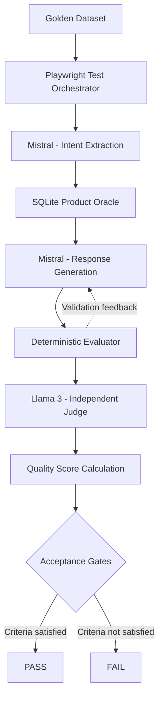

# Enterprise AI Quality Lab — System Architecture

## Overview

The framework uses a multi-stage AI evaluation pipeline combining deterministic validation with independent LLM-based semantic evaluation.

## Architecture Flow

## Component Responsibilities

| Component | Responsibility |
|---|---|
| Golden Dataset | Defines evaluation scenarios and expected filters |
| Playwright | Orchestrates evaluation execution |
| Mistral | Intent extraction and response generation |
| SQLite Product Oracle | Retrieves authoritative expected product data |
| Deterministic Evaluator | Checks correctness, completeness and traceability |
| Llama 3 Judge | Evaluates grounding, hallucination, relevance, semantic completeness and toxicity |
| Quality Assessment | Calculates scores and evaluates acceptance criteria |

## Evaluation Methodology

### Deterministic Evaluation
- Correctness
- Completeness
- Traceability

### Independent LLM Evaluation
- Grounding
- Hallucination
- Relevance
- Semantic Completeness
- Toxicity

## Design Principles

- Separate response generation from evaluation.
- Validate factual information against authoritative data.
- Evaluate semantic quality independently.
- Measure completeness separately from correctness.
- Use explicit quality acceptance criteria.

## Portfolio Disclosure

This document provides a high-level architectural overview. Proprietary source code, internal prompts, evaluation implementation and database contents are not included.

